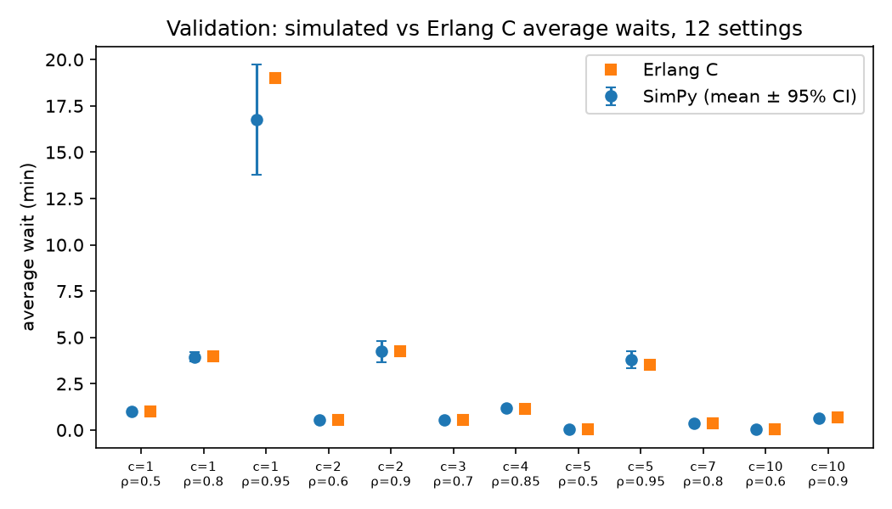

# Where the call-center formula breaks, and can an LLM do queueing math?

A simulation study with a small LLM check. How many agents keep waits acceptable in a simple service queue? The study builds a discrete-event simulator, checks it against the textbook formula it should reproduce (Erlang C), uses it where the formula stops working, and then asks three open language models the same questions three ways.

The plan and decision rules were frozen before the LLM main run (PLAN.md, with SHA-256 hashes in FREEZE_MANIFEST.txt); pilots before the freeze were used only for model selection. Total spend about $0.39 on Together AI (SPEND.md).

**Tool built from this study:** [Call Center Staffing Planner](https://omidgolchin.github.io/queue-simulator/) ([code](https://github.com/omidgolchin/queue-simulator)), which turns the validated simulator and formula into an hour-by-hour staffing plan.

## Results

**1. The simulator reproduces the formula.** Across 12 M/M/c settings (1 to 10 servers, utilisation 0.5 to 0.95, 16 replications each), the Erlang C wait falls inside the simulation's 95% interval in 12 of 12; Little's law holds within 0.12%.

**2. Where the formula stops working.**
- *Call-length variability.* Same arrivals, same average call length, 4 agents: the formula says 1.07 min. Simulated: 1.04 min for exponential calls, 0.70 min for steadier calls (CV 0.5), 2.05 min for very variable calls (lognormal, CV 2).
- *Callers who hang up.* At 95% utilisation with 5 agents the formula predicts 26.3 min. With 10-minute average patience, 14.7% of callers give up and served callers wait 1.3 min.
- *Rush hours.* Staffing a day shaped like NYC 311 demand at the average hour's answer (8 agents), the formula and a flat day give 0.28 min; the shaped day gives 2.92 min, with 41.4% of callers waiting over 20 seconds.

**3. Can a language model do this?** 15 scenarios (plain formula, formula with a trap, beyond the formula) × three open models × three modes:
- *Asked directly,* all three were close on 9 of 15, weakest where the formula breaks.
- *Asked to write code,* gpt-oss-120b was close on 14 of 15, MiniMax-M3.1-Flash on 7, GLM-5.3-Flash on 2.
- *Asked to simulate 20 customers by hand,* they tracked 45–58% of customers before drifting.

It is a small check with three models, not a ranking. Full tables, ground truth per scenario and every scored answer: [results/summary.md](results/summary.md) and `outputs/llm_scores.json`.



## Limitations

- One queue with identical servers; no skills-based routing, callbacks or multi-stage service.
- Arrival data: only the hourly shape of NYC 311 requests (January 2024) is borrowed, scaled to a 60-calls-per-hour centre; 311 requests are not calls to one centre (DATA_SOURCES.md). The standard bank call-center dataset is registration-gated.
- Integrity note: `src/queuesim/score.py` and `src/queuesim/analyze.py` no longer match their hashes in FREEZE_MANIFEST.txt, and the change is not in PLAN.md's amendment log. The current code regenerates the published results exactly; the frozen versions were not kept, so the difference cannot be shown here. The manifest's `docs/` entries belong to the tool's page and live in the tool's repository.
- The LLM check uses 15 scenarios, three models and one sampling setting (temperature 0.7); the thresholds for "close" were fixed in advance, and raw errors are reported alongside.

## Reproduce

```bash
python3 -m venv .venv && .venv/bin/pip install -r requirements.txt
make test         # simulator and formula tests
make reproduce    # regenerates results/summary.md and the figures from outputs/
make validate     # reruns the simulation studies (slow the first time)
```

Rerunning the model calls needs a Together API key and is not needed to reproduce any number above.

By Omid Golchin. MIT-licensed (LICENSE).
